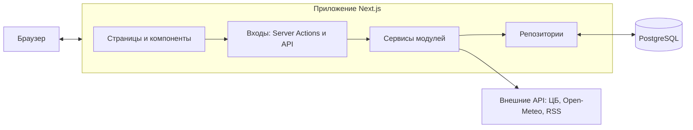
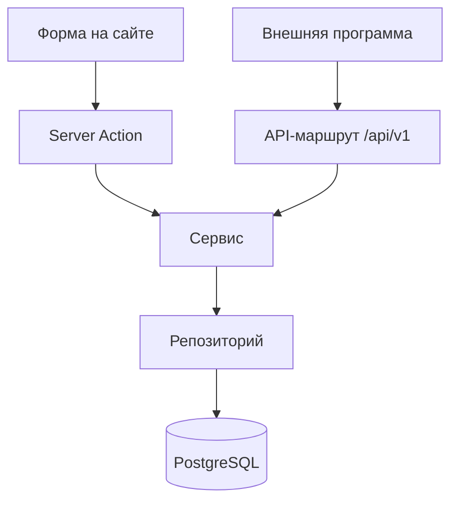
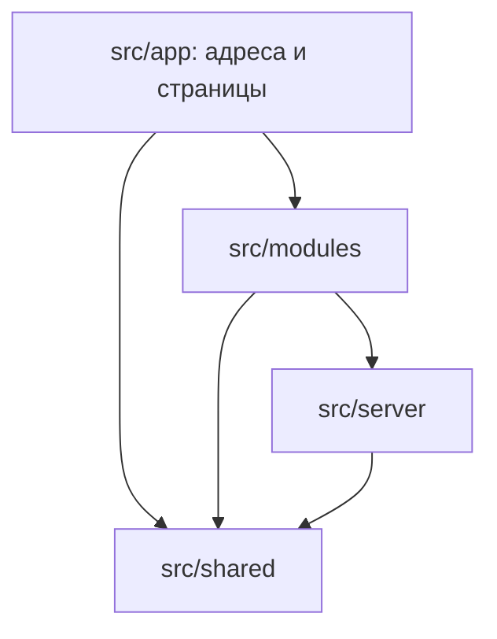

# 03. Архитектура

## Коротко

Avocado Travel — **модульный монолит** на Next.js. Одно приложение, один деплой, одна база данных PostgreSQL. Внутри приложение разрезано на независимые **модули**: каждый сервис сайта (бронирование, гостевая книга, форум, статистика…) живёт в своей папке и содержит всё нужное ему. Внутри модуля код разложен по **слоям** с одной обязанностью у каждого.



## Стек

| Задача | Технология | Почему |
|---|---|---|
| Язык | TypeScript (строгий режим) | Ошибки ловятся до запуска, типы общие для клиента и сервера |
| Фреймворк | Next.js (App Router) + React | Самый востребованный React-фреймворк; страницы рендерятся на сервере, что нужно для поисковиков и валидатора W3C. [ADR-0001](adr/0001-nextjs-modular-monolith.md) |
| База данных | PostgreSQL | Стандарт индустрии; встроенный полнотекстовый поиск с русской морфологией. [ADR-0002](adr/0002-postgresql-drizzle.md) |
| Работа с базой | Drizzle ORM + drizzle-kit | Типобезопасные запросы близко к SQL, миграции в git |
| Проверка данных | Zod | Одна схема и для проверки ввода, и для типов TypeScript |
| Авторизация | Better Auth | Готовые регистрация, вход, сессии, роли; хранит данные в нашей базе. [ADR-0005](adr/0005-better-auth.md) |
| Стили | Tailwind CSS | Стандарт для React-проектов; дизайн-токены в одном месте |
| Графики | Recharts | Простые React-графики для аналитики |
| Внешние ленты | fast-xml-parser | Разбор RSS и Atom без своих регулярных выражений; без зависимостей |
| Карта | Leaflet + OpenStreetMap | Бесплатно, без ключей; Leaflet загружается только в браузере, на странице «Сервисы» |
| Тесты | Vitest (модульные), Playwright (сквозные) | Быстрые и стандартные |
| Качество кода | ESLint, Prettier, html-validate | Автоматическая проверка стиля и валидности HTML |
| Окружение | Docker Compose | PostgreSQL на ноутбуке одной командой |
| Хостинг | Render (Docker) + Neon (PostgreSQL) + cron-job.org | Бесплатно без срока, открывается из России. [ADR-0009](adr/0009-hosting-render-neon.md), [09-deploy.md](09-deploy.md) |
| Пакетный менеджер | pnpm | Быстрее и строже npm |
| CI | GitHub Actions | Проверки на каждый PR; ручной workflow «Боевая база» — миграции и демо-данные на хостинге ([09-deploy.md](09-deploy.md)) |

Версии фиксируются в `package.json` на момент старта проекта (актуальные стабильные). Node.js — текущая LTS.

## Основные принципы

1. **Модуль на сервис.** Всё, что относится к гостевой книге, лежит в `src/modules/guestbook/`. Модуль можно скопировать в другой проект — это требование методички к сервисам.
2. **Один слой — одна обязанность.** Компонент не ходит в базу, репозиторий не знает про HTTP, сервис не знает про React.
3. **Зависимости только вниз.** Нижний слой никогда не импортирует верхний.
4. **Сервер — источник правды.** Всё, что приходит из браузера, проверяется на сервере, даже если уже проверено в форме.
5. **Типы из одного места.** Таблица описана в Drizzle-схеме, правила ввода — в Zod-схеме, а типы TypeScript выводятся из них, а не пишутся руками второй раз.

## Модули

| Модуль | Назначение |
|---|---|
| `catalog-data` | Справочники: аэропорты, авиакомпании, модели самолётов |
| `flights` | Рейсы, поиск рейсов, схема салона и занятость мест |
| `booking` | Заказы, билеты, демо-оплата, отмена, автоотмена неоплаченных |
| `auth` | Обёртка над Better Auth: сессия, роли, проверка прав |
| `news` | Новости сайта и импортированные новости отрасли |
| `press` | Пресс-релизы из JSON-файла (лаба 2). Без базы — данные в `content/press/` |
| `guestbook` | Гостевая книга с модерацией |
| `forum` | Форум |
| `search` | Полнотекстовый поиск по сайту |
| `help` | Справка: вопросы и ответы с оглавлением на якорях. Без базы — текст в коде |
| `stats` | Счётчик посещений и статистика |
| `rating` | Рейтинг сайта |
| `poll` | Опрос |
| `catalog` | Каталог полезных ресурсов (коллекция ссылок) |
| `ads` | Рекламные кампании, показы, клики |
| `currency` | Курсы ЦБ: баннер и конвертер |
| `weather` | Погода: баннер |
| `route-map` | Карта маршрутов |
| `world-clock` | Мировые часы и календарь |
| `analytics` | Отчёты и графики (лаба 3). Своих таблиц нет — читает заказы, рейсы и справочники |
| `exchange` | Публичный API, CSV, JSON Feed, импорт RSS (лаба 4) |

### Устройство модуля

```
src/modules/guestbook/
├── index.ts            # общий вход: типы, схемы, таблицы, чистые функции (можно везде, без React)
├── ui.ts               # вход компонентов из ui/
├── server.ts           # серверный вход: сервисы (import 'server-only'), ADR-0008
├── schema.ts           # таблицы Drizzle
├── model.ts            # Zod-схемы ввода и типы
├── server/
│   ├── repository.ts   # единственное место с запросами к базе
│   ├── service.ts      # бизнес-правила
│   ├── service.test.ts # модульные тесты правил
│   └── actions.ts      # Server Actions для наших форм
└── ui/
    ├── GuestbookList.tsx
    └── GuestbookForm.tsx
```

Модуль без какой-то части её просто не содержит: у `world-clock` нет базы, значит нет `schema.ts` и `repository.ts`.

### Что делает каждый слой

| Слой | Обязанность | Чего не делает |
|---|---|---|
| `ui/` | Показывает данные, собирает ввод, вызывает action | Не обращается к базе, не содержит бизнес-правил |
| `actions.ts` и API-маршруты | Вход на сервер: проверка прав и формата (Zod), вызов сервиса, ответ | Не пишет SQL, не решает бизнес-вопросы |
| `service.ts` | Бизнес-правила: стоп-слова, бан по IP, проверка свободных мест, расчёт цены | Не знает про HTTP, React и SQL |
| `repository.ts` | Чтение и запись в базу через Drizzle | Не принимает решений |

### Два входа на сервер

У сервера два вида входа, и оба вызывают **одни и те же сервисы**:

- **Server Actions** — для форм и кнопок нашего собственного сайта (оставить запись, забронировать, отменить). Это функции, которые React вызывает на сервере напрямую.
- **API-маршруты** (`src/app/api/...`) — для внешних программ: публичный REST API (лаба 4), выгрузки, служебные адреса (счётчик, перенаправление рекламы, задания по расписанию).



### Правила зависимостей



- У модуля до трёх публичных входов: `index.ts` — общее (типы, Zod-схемы, таблицы, чистые функции), безопасное и в браузере, без React; `ui.ts` — компоненты; `server.ts` — сервисы, только для сервера. Подробнее — [ADR-0008](adr/0008-module-server-entry.md).
- `src/app` импортирует модули только через эти входы и может напрямую брать общее из `src/shared`. В `src/server` страницы и маршруты не ходят: база, авторизация и секреты доступны им только через сервисы модулей.
- Модуль импортирует другой модуль только через его входы, никогда не лезет во внутренние файлы.
- `src/server` ничего не знает о модулях: это инфраструктура (подключение к базе, переменные окружения, заголовки запроса), которой модули пользуются, а не наоборот.
- **Таблицы между модулями.** Модуль публикует свои таблицы через `index.ts`. Другой модуль может ссылаться на них во внешних ключах своего `schema.ts` и **читать** их в своём `repository.ts` (например, `JOIN` рейсов с аэропортами). **Изменять** данные чужого модуля — только через сервис модуля-владельца. Линтер это не проверяет, правило держится на ревью. Подробнее — [ADR-0007](adr/0007-db-schema-without-aggregator.md).
- Код из `server/` никогда не попадает в клиентские компоненты (файлы помечаются `import 'server-only'`).
- Правила проверяются автоматически линтером (`eslint-plugin-boundaries`), нарушение роняет CI.

## Структура проекта

```
avocado-travel/
├── src/
│   ├── app/                    # маршрутизация Next.js: только адреса и сборка страниц
│   │   ├── _components/        #   шапка, подвал — части общего макета (могут брать виджеты модулей)
│   │   ├── (site)/             #   публичные страницы
│   │   ├── (auth)/             #   вход и регистрация
│   │   ├── account/            #   личный кабинет
│   │   ├── admin/              #   админка
│   │   ├── api/                #   API-маршруты
│   │   ├── feed.json/          #   JSON Feed
│   │   ├── help/               #   справка
│   │   ├── sitemap.ts          #   sitemap.xml
│   │   └── robots.ts           #   robots.txt
│   ├── modules/                # модули, по одному на сервис
│   ├── shared/
│   │   ├── ui/                 #   общие компоненты: Button, Input, Card, Table…
│   │   ├── lib/                #   утилиты: форматирование дат и денег, ошибки, метаданные страниц
│   │   └── config/             #   константы сайта, навигация
│   ├── instrumentation.ts      # при запуске сервера: проверка переменных, миграции в Docker-образе
│   └── server/
│       ├── db.ts               #   подключение к базе (без схем модулей, см. ADR-0007)
│       ├── migrate.ts          #   применение миграций без drizzle-kit (для Docker-образа)
│       ├── cron.ts             #   проверка секрета заданий по расписанию
│       ├── env.ts              #   проверка переменных окружения
│       ├── rate-limit.ts       #   ограничение частоты запросов по ключу (IP)
│       └── request.ts          #   IP и заголовки запроса
├── content/press/              # JSON-данные и схема для лабы 2
├── db/
│   ├── migrations/             # миграции, генерируются drizzle-kit
│   └── seed/                   # скрипты демо-данных
├── scripts/
│   ├── jobs/                   # задания по расписанию для ручного запуска (pnpm job:…)
│   └── check-russia.ts         # проверка доступности сайта из России (pnpm check:russia)
├── public/                     # статика: иконки, иллюстрации
├── tests/e2e/                  # сквозные тесты Playwright
├── docs/                       # документация
├── .github/                    # CI, шаблон PR
├── docker-compose.yml          # база для разработки
├── Dockerfile                  # образ сайта для хостинга
├── render.yaml                 # настройки сервиса на Render
├── drizzle.config.ts           # drizzle-kit: где схемы (src/modules/*/schema.ts) и куда класть миграции
├── CLAUDE.md
└── README.md
```

## Рендеринг

- По умолчанию все компоненты **серверные**: HTML собирается на сервере и приходит в браузер готовым. Это важно для поисковиков и валидатора.
- **Клиентские компоненты** (`'use client'`) — только там, где нужна интерактивность в браузере: схема салона, карта, конвертер, часы, графики. Они маленькие и получают данные от серверного родителя.
- Данные для страницы загружаются в серверном компоненте через сервис модуля.
- Внешние данные (курсы ЦБ, погода) кэшируются: курсы — на час, погода — на 30 минут. Если внешний сервис недоступен, виджет показывает аккуратную заглушку, а не роняет страницу.
- Запросы к внешним сервисам идут через `src/server/external.ts`: ответ ждём 3 секунды, а после сбоя адрес 5 минут не запрашиваем вовсе — иначе каждая страница ждала бы таймаута заново. Курсы ЦБ берутся из официального XML по `http://`: по https сайт ЦБ отвечает не из всех сетей, а курсы — открытые данные, показываемые только для справки.

## Конфигурация

- Все настройки — через переменные окружения. Образец со всеми ключами — `.env.example`, реальный `.env` в git не попадает.
- `src/server/env.ts` проверяет переменные через Zod при старте (его загружает `src/instrumentation.ts`). Если чего-то не хватает, приложение не запустится и скажет, чего именно. На время `next build` проверка отключена: сборка в базу не ходит, и секреты ей не нужны.
- Основные переменные: `DATABASE_URL`, `BETTER_AUTH_SECRET`, `ADMIN_EMAIL`, `ADMIN_PASSWORD`, `IP_HASH_SALT`, `CRON_SECRET`, `NEXT_PUBLIC_SITE_URL`, `NEXT_PUBLIC_YANDEX_METRIKA_ID`, `YANDEX_VERIFICATION`; на хостинге ещё `CLIENT_IP_HEADER` и `DB_MIGRATE_ON_START` ([09-deploy.md](09-deploy.md)).

## Авторизация

- Better Auth: регистрация и вход по почте и паролю, сессия в cookie, данные пользователей в нашей базе.
- Настройка Better Auth живёт в модуле `auth` (`src/modules/auth/server/auth.ts`) вместе с его таблицами. Наружу через `server.ts` модуль отдаёт проверку сессии и роли, а также обработчик для маршрута `src/app/api/auth/[...all]/route.ts`.
- У пользователя поле `role`: `customer` или `admin`. Новый список ролей — одна строка в коде.
- Администратор создаётся сид-скриптом из `ADMIN_EMAIL` и `ADMIN_PASSWORD`; повторный запуск обновляет его пароль, а не создаёт второго.
- Раздел `/admin` и админские действия проверяют роль **на сервере**, в каждом action и маршруте. Скрытая кнопка в интерфейсе защитой не считается.
- Проверки — функции модуля: `getCurrentUser()` (кто вошёл или `null`), `requireUser(адрес возврата)` (иначе — на вход с `?next=…`), `requireAdmin()` (покупателю — 404, как будто раздела нет). Они вызываются в каждой закрытой странице, а не в общем `layout`: Next.js не перерисовывает layout при переходах между дочерними страницами.
- Формы входа и регистрации отправляются через Server Actions, поэтому работают и без JavaScript. Адрес возврата `next` принимается только внутренний (`/…`), чтобы ссылкой нельзя было увести пользователя на чужой сайт.
- Частота попыток с одного IP: вход — 10 в минуту, регистрация — 10 за 10 минут (`src/server/rate-limit.ts`, счётчики в памяти процесса). Встроенный ограничитель Better Auth работает только для его HTTP-маршрутов, а не для вызовов из Server Actions. Для сквозных тестов ограничение отключается переменной `RATE_LIMIT_DISABLED=true` (её ставит `playwright.config.ts`), сам ограничитель проверяют модульные тесты.
- Шапка показывает, кто вошёл, поэтому сессия проверяется на каждой странице. Чтобы не ходить в базу каждый раз, Better Auth держит подписанную копию сессии в cookie 5 минут.

## Задания по расписанию

Два фоновых задания:

- импорт новостей из внешних RSS-лент — раз в 6 часов;
- автоотмена неоплаченных заказов — раз в 5 минут; на хостинге — раз в час, чтобы не будить бесплатную базу ([09-deploy.md](09-deploy.md#расписание)).

Каждое задание — API-маршрут в `src/app/api/cron/`, защищённый заголовком `Authorization: Bearer <CRON_SECRET>`; без него — 401. Обработчик маршрута отдаёт модуль-владелец через `server.ts` (например, `handleExpireOrdersCron` из `booking`), а маршрут только подключает его. Локально они запускаются командами `pnpm job:import-feeds` и `pnpm job:expire-orders`, на хостинге — внешним планировщиком cron-job.org. Кроме того, при открытии брони сервис сам считает просроченные `pending`-заказы недействительными, поэтому расписание не критично для корректности.

## Безопасность

- **Ввод:** всё проверяется Zod на сервере.
- **XSS:** React экранирует вывод по умолчанию. `dangerouslySetInnerHTML` запрещён; если нужен форматированный текст новостей — только через санитайзер.
- **SQL-инъекции:** запросы только через Drizzle с параметрами, без склейки строк.
- **CSRF:** Server Actions защищены Next.js; изменяющие API-маршруты требуют сессию или секрет.
- **Частота запросов:** формы гостевой книги, форума, входа и регистрации ограничены по IP.
- **IP посетителя** берётся из заголовков прокси через одну функцию в `src/server/request.ts`. Если хостинг ставит свой заголовок с адресом посетителя, который нельзя подделать, его имя задаётся в `CLIENT_IP_HEADER`: на Render это `true-client-ip` — его перезаписывает Cloudflare перед Render, а последним в `X-Forwarded-For` там стоит внутренний адрес Render. Без этой переменной берётся **последний** адрес из `X-Forwarded-For` — его дописывает прокси. Первые адреса списка присылает сам браузер, по ним бан и ограничение частоты обходились бы одним заголовком. В статистике IP хранится как хэш с солью.
- **Секреты** — только в переменных окружения.

## Ошибки и логи

- Ожидаемые ошибки (место занято, слово запрещено) — это результат, а не исключение: сервис возвращает объект `{ ok: false, error: 'SEAT_TAKEN' }`, а интерфейс показывает понятное сообщение.
- Неожиданные ошибки ловятся границами ошибок Next.js (`error.tsx`), пользователь видит дружелюбную страницу, подробности уходят в лог сервера.
- Свои страницы 404 и 500 в стиле сайта.

## Тестирование

| Уровень | Чем | Что проверяем |
|---|---|---|
| Модульные | Vitest | Бизнес-правила сервисов: стоп-слова, расчёт цены, код брони, разбор поискового запроса |
| Интеграционные | Vitest + тестовая база в Docker | Репозитории и сложные запросы: занятость мест, отчёты аналитики |
| Сквозные | Playwright | Ключевые сценарии в браузере: поиск → бронь → кабинет → отмена (`tests/e2e/scenario.spec.ts`); гостевая книга; админка. Общие шаги — в `tests/e2e/helpers.ts` |
| Валидность HTML | html-validate | HTML всех публичных страниц |

Подробности и критерии — [07-conventions.md](07-conventions.md).
