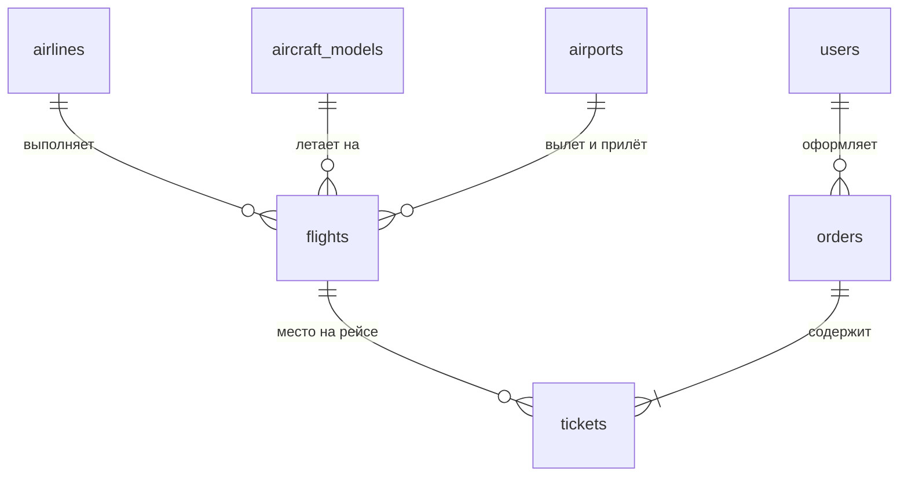

# 04. Модель данных

База — PostgreSQL. Таблицы описываются в `schema.ts` своих модулей, миграции генерирует drizzle-kit в `db/migrations/`. Имена таблиц и колонок — `snake_case` на английском.

Общие правила:

- первичный ключ `id`: `uuid` для пользовательских сущностей (заказы, сообщения), `serial` для справочников;
- в TypeScript поля называются в camelCase (`createdAt`), в базе — в snake_case (`created_at`); Drizzle переводит имена сам (настройка `casing: 'snake_case'`), второй раз имя колонки не пишется;
- время хранится в `timestamptz` (UTC), в интерфейсе показывается в часовом поясе аэропорта или пользователя; сама база работает в UTC — это задаёт первая миграция;
- деньги — целые **копейки** в `integer`, чтобы не было ошибок округления дробных чисел;
- у изменяемых сущностей есть `created_at` и `updated_at`.

## Предметная область

Сущности из темы методички «вид транспорта – билет – заказчик – номер рейса»:

| Методичка | Таблица |
|---|---|
| Вид транспорта | `aircraft_models` — модель воздушного судна |
| Номер рейса | `flights` |
| Заказчик | `users` (покупатель) |
| Билет | `tickets` (внутри `orders`) |

### `airports` — аэропорты

| Поле | Тип | Описание |
|---|---|---|
| id | serial | |
| iata | char(3), уникальное | Код аэропорта, например `SVO` |
| name | text | «Шереметьево» |
| city | text | «Москва» |
| city_slug | text | `moscow`, для адресов `/destinations/moscow` |
| country | text | |
| lat, lon | double precision | Координаты для карты и погоды |
| timezone | text | Например `Europe/Moscow` |

Отдельной таблицы городов нет: город — это аэропорты с одинаковым `city_slug` (в Москве их три). Описания городов для страниц направлений — редакционный текст, он хранится в коде модуля (`catalog-data/cities.ts`), иллюстрации — в `public/images/destinations/<city_slug>.svg`.

### `airlines` — авиакомпании (выдуманные)

| Поле | Тип | Описание |
|---|---|---|
| id | serial | |
| code | text, уникальное | Внутренний код из трёх латинских букв, например `LST`. Настоящие двухбуквенные коды ИАТА не используем: они принадлежат реальным компаниям |
| name | text | «Ластавиа» |
| color | text | Фирменный цвет для логотипа и карточек |
| logo | text | Адрес SVG на сайте, например `/images/airlines/lastavia.svg` (файл в `public/images/airlines/`) |
| description | text | |
| baggage_included | boolean | Включён ли багаж в эконом |

### `aircraft_models` — модели самолётов («вид транспорта»)

| Поле | Тип | Описание |
|---|---|---|
| id | serial | |
| manufacturer | text | Airbus, Boeing, Sukhoi |
| model | text | A320neo |
| business_rows | integer | Сколько первых рядов — бизнес |
| business_layout | text | Схема мест в ряду бизнеса, например `AC-DF` |
| economy_rows | integer | |
| economy_layout | text | Например `ABC-DEF` |

Вместимость и схема салона вычисляются из этих полей, как и ряды с местом для ног (первый ряд эконома и ряд у выхода посередине эконома).

### `flights` — рейсы

| Поле | Тип | Описание |
|---|---|---|
| id | uuid | |
| number | text | Номер рейса: код авиакомпании + число, `LST 1204` |
| airline_id | → airlines | |
| aircraft_model_id | → aircraft_models | |
| origin_id | → airports | |
| destination_id | → airports | |
| departs_at | timestamptz | |
| arrives_at | timestamptz | |
| price_economy | integer | Базовая цена эконома, копейки |
| price_business | integer | Базовая цена бизнеса, копейки |

Индекс по `(origin_id, destination_id, departs_at)` — для поиска. Уникальность `(number, departs_at)`. Проверки в самой базе: прилёт позже вылета, аэропорты вылета и прилёта разные, цены положительные.

Демо-расписание (`db/seed/flights.ts`): Москва летает во все 19 городов, Петербург — в 10 крупных, плюс 12 региональных пар; каждый маршрут — в обе стороны, от 1 до 6 рейсов в день, некоторые — по дням недели. Время в пути и цена зависят от расстояния, самолёт — от дальности и парка авиакомпании. Около 30 тысяч рейсов.

### `orders` — заказы

| Поле | Тип | Описание |
|---|---|---|
| id | uuid | |
| user_id | → users | |
| pnr | char(6), уникальное | Код брони |
| status | enum `pending` / `paid` / `cancelled` | |
| total | integer | Сумма, копейки |
| expires_at | timestamptz | Когда истекает `pending` |
| paid_at, cancelled_at | timestamptz, null | |
| created_at | timestamptz | |

### `tickets` — билеты

| Поле | Тип | Описание |
|---|---|---|
| id | uuid | |
| order_id | → orders | |
| flight_id | → flights | |
| cabin_class | enum `economy` / `business` | |
| seat | text | `12C` |
| passenger_first_name | text | |
| passenger_last_name | text | |
| price | integer | Зафиксированная цена, копейки |
| is_active | boolean | `false` после отмены заказа |

**Частичный уникальный индекс** `(flight_id, seat) WHERE is_active` — база не даст продать одно место дважды, даже если два покупателя нажмут кнопку одновременно.

Место занято, если на него есть действующий билет, а заказ оплачен или ещё ждёт оплаты и не просрочен. Это условие записано один раз (`src/modules/booking/held.ts`); им пользуются и бронирование, и поиск со схемой салона в модуле `flights`, который читает таблицы билетов в своём репозитории (ADR-0007). Перед созданием заказа просроченные неоплаченные заказы отменяются в той же транзакции, чтобы индекс освободил их места.

## Пользователи и авторизация

Таблицы `users`, `sessions`, `accounts`, `verifications` создаёт Better Auth. К `users` добавлено поле `role` (`customer` / `admin`).

## Сервисы сайта

### `news` — новости

| Поле | Тип | Описание |
|---|---|---|
| id | uuid | |
| slug | text, уникальное | Для адреса `/news/[slug]` |
| title | text | |
| summary | text | Краткое описание |
| body | text | Текст новости |
| category | text | |
| source | enum `site` / `external` | Своя новость или импортированная |
| external_url | text, null | Ссылка на оригинал для импортированных |
| external_feed | text, null | Из какой ленты |
| tags | text[] | Автоматические теги для импортированных |
| published_at | timestamptz | |

Уникальный индекс по `external_url` — защита от повторного импорта.

Текст новости — обычный текст, абзацы разделены пустой строкой; HTML не хранится, поэтому санитайзер не нужен. Рубрики своих новостей — `company`, `routes`, `promo`, `service` (список в `src/modules/news/model.ts`). Адрес по умолчанию собирается из заголовка транслитерацией. Новость с `published_at` в будущем посетители не видят, пока дата не наступит.

### `guestbook_entries`, `guestbook_stop_words`, `guestbook_banned_hosts`

| Таблица | Поля |
|---|---|
| `guestbook_entries` | id, author_name, message, ip, user_agent, is_visible, hidden_reason (`stop_word` / `admin`), created_at |
| `guestbook_stop_words` | id, word (уникальное, в нижнем регистре) |
| `guestbook_banned_hosts` | id, pattern (IP или подсеть в формате `inet`/`cidr`), comment, created_at |

### `forum_topics`, `forum_posts`

| Таблица | Поля |
|---|---|
| `forum_topics` | id, title, author_id → users, created_at, last_post_at, posts_count |
| `forum_posts` | id, topic_id → forum_topics, author_id → users, body, created_at, updated_at |

### `page_views` — статистика

| Поле | Тип | Описание |
|---|---|---|
| id | bigserial | |
| path | text | Адрес страницы |
| section | text | Раздел сайта (первая часть адреса) |
| visitor_hash | text | Хэш IP с солью и датой |
| referrer_host | text, null | Откуда пришли |
| created_at | timestamptz | |

### `site_ratings`, `polls`, `poll_options`, `poll_votes`

| Таблица | Поля |
|---|---|
| `site_ratings` | id, score (1–5), visitor_hash, created_at; уникально `(visitor_hash, дата)` |
| `polls` | id, question, is_active, created_at |
| `poll_options` | id, poll_id, text, position |
| `poll_votes` | id, poll_id, option_id, voter_key (id пользователя или хэш посетителя); уникально `(poll_id, voter_key)` |

### `catalog_sections`, `catalog_links` — каталог ресурсов

| Таблица | Поля |
|---|---|
| `catalog_sections` | id, parent_id → catalog_sections (null для корня), title, position, is_visible |
| `catalog_links` | id, section_id, title, url, description, position, is_visible |

### `ad_campaigns`, `ad_events` — реклама

| Таблица | Поля |
|---|---|
| `ad_campaigns` | id, title, text, image, target_url, placement (`home` / `search`), starts_at, ends_at, is_enabled, created_at |
| `ad_events` | id, campaign_id, type (`impression` / `click`), created_at |

### Поиск по сайту

Отдельная таблица `search_documents`: id, kind (`page` / `news` / `forum`), ref_id, url, title, body, `tsv` (`tsvector` с русской конфигурацией), updated_at. GIN-индекс по `tsv`. Документы обновляются при сохранении новостей и сообщений форума; статические страницы индексируются сид-скриптом.

## Демо-данные

Сид-скрипты лежат в `db/seed/`, запускаются `pnpm db:seed`: `index.ts` очищает таблицы и вызывает файлы модулей (`catalog-data.ts` и следующие) в одной транзакции. Генерация **детерминированная**: при каждом запуске получаются одни и те же данные (фиксированный seed генератора случайных чисел), поэтому тесты и скриншоты воспроизводимы. Скрипты пишут в базу через Drizzle напрямую — это инструмент разработчика, а не код сайта.

Аэропорты: Москва (SVO, VKO, DME), Санкт-Петербург, Калининград, Сочи, Казань, Владивосток, Екатеринбург, Новосибирск, Самара, Уфа, Красноярск, Иркутск, Минеральные Воды; Стамбул, Дубай, Ереван, Ташкент, Пекин. У каждого города своя иллюстрация `public/images/destinations/<city_slug>.svg`.

| Данные | Объём |
|---|---|
| Аэропорты | 20 реальных: 15 российских, 5 зарубежных |
| Авиакомпании | 6 выдуманных, у каждой свой цвет и логотип |
| Модели самолётов | 5: Airbus A320neo, Airbus A321neo, Boeing 737-800, Boeing 777-300ER, Sukhoi Superjet 100 |
| Рейсы | Регулярное расписание на 60 дней вперёд и 180 дней назад |
| Демо-покупатели | 200 |
| Заказы | Прошедшие полгода, с реалистичной сезонностью и долей отмен около 8% — данные для аналитики |
| Новости | 12 своих |
| Форум | 5 тем, 30 сообщений |
| Гостевая книга | 15 записей, 5 стоп-слов |
| Каталог ресурсов | 4 раздела, 20 ссылок |
| Опрос | 1 активный с 5 вариантами |
| Реклама | 4 кампании, одна выключена, одна с истёкшим сроком |
| Администратор | Из `ADMIN_EMAIL` и `ADMIN_PASSWORD` |
